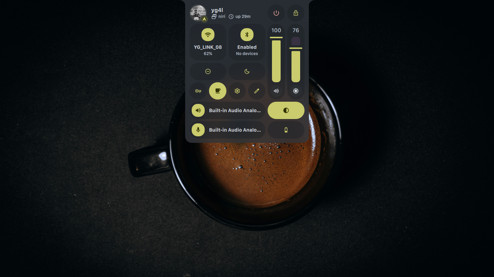
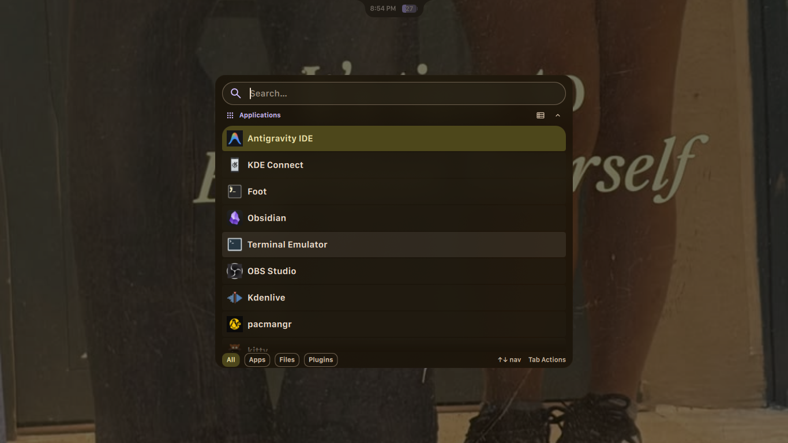
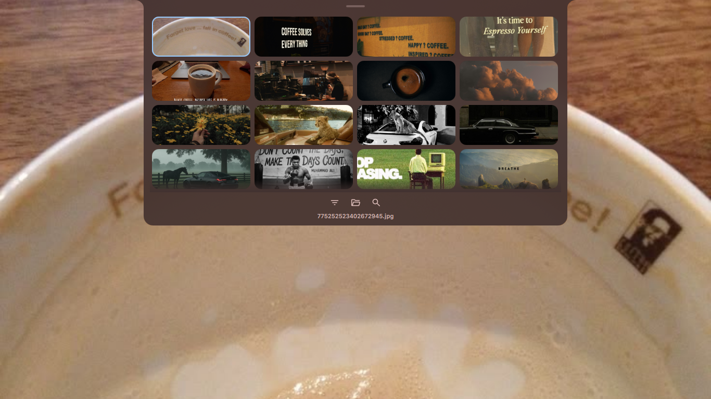
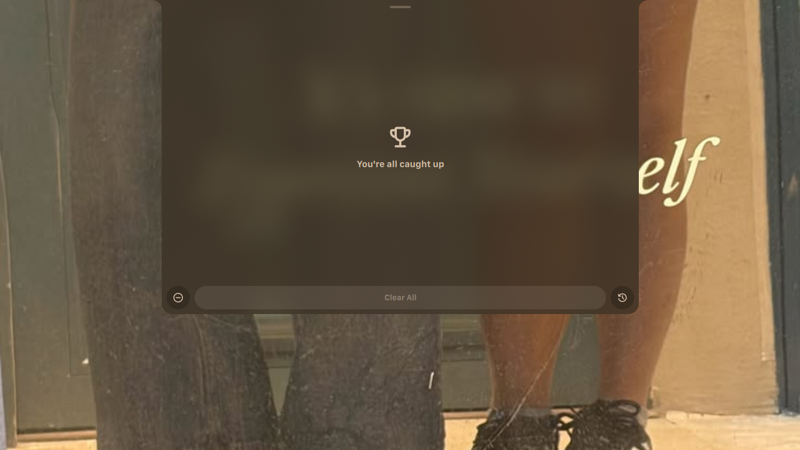
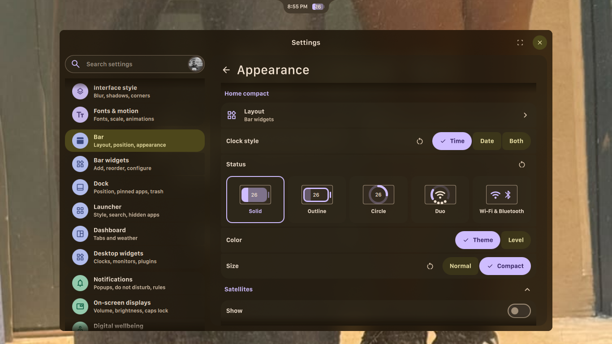
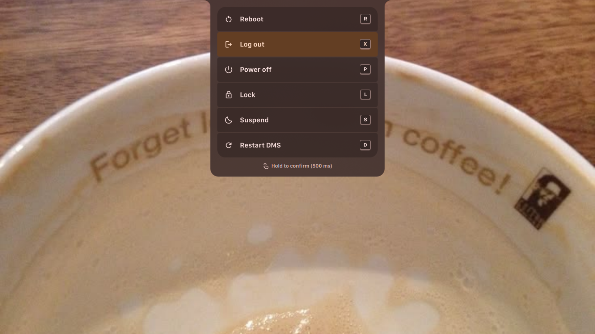

# dms-ios-inspired

An iOS-inspired setup for [Dank Material Shell (DMS)](https://github.com/Dux-Labs/danklinux) / [Quickshell](https://quickshell.org/) on **Niri (Wayland)**, tuned for an island-style bar, control-center layout, blur/transparency, and low-memory runtime options.

This repo packages the configuration/theme/integration files needed to reproduce this setup state (not a fork of DMS shell source).

## Screenshots

|  |  |
|---|---|
|  |  |
| **Notch / Island Bar** | **Control Panel** (`Mod+A`) |
|  |  |
| **App Launcher** (`Mod+Space`) | **Wallpaper Selector** (`Mod+W`) |
|  |  |
| **Notifications** (`Mod+N`) | **Settings** |
|  |  |
| **Power / Logout Menu** |  |


## Download

### Git clone (recommended)
```bash
git clone https://github.com/okyashgajjar/dms-ios-inspired.git
cd dms-ios-inspired
```

### One-command install (after you host this repo)
```bash
bash <(curl -fsSL https://raw.githubusercontent.com/okyashgajjar/dms-ios-inspired/main/install.sh)
```

## RAM usage (measured)

| Component | RAM (approx.) | Notes |
|---|---:|---|
| **DMS** (`qs` + `dms`) | **~655 MiB** | Shell UI + backend (cgroup, idle/light use) |
| **Niri** | **~145 MiB** | Wayland compositor |
| **DMS + Niri** | **~800 MiB** | Typical combined footprint for this setup |

> Measured on this system (7.3 GiB RAM, Wayland/Niri). Actual usage varies with session uptime, widgets/activity, monitors, and workloads.

## Demo

<video src="demo.mp4" controls muted playsinline width="100%"></video>

If the video doesn't render inline, [open/download demo.mp4](demo.mp4).


## What's included

- `config/dms/settings.json` — DMS UI/layout/settings (iOS-inspired island bar, control center, widgets, blur enabled, dense/expressive styling, etc.)
- `config/dms/themes/detroit67/` — custom `detroit67` theme
- `config/dms/plugins.lock.json` — plugin lockfile
- `config/dms/firefox.css` — optional Firefox styling
- `config/systemd/user/dms.service.d/light.conf` — user service drop-in (runtime tuning env flags)
- `config/niri/config.kdl` — Niri config used with this setup (sanitized for portability; review monitor/debug sections)
- `config/niri/dms/*.kdl` — DMS/Niri integration snapshots (binds, layout, blur, window rules, colors, cursor, input, alttab). `outputs.kdl.example` is included as reference only (machine-specific).
- `install.sh` — installer with timestamped backups

## Requirements

- Linux + Wayland
- **Niri** compositor
- **DMS** (`dms`) and **Quickshell** installed
- `systemd --user` session
- Recommended for intended look: **SF Compact Text** font (falls back if missing)
- Optional apps referenced by binds/config: `foot`, `firefox`, `zed`, `nautilus`, `spotify` (Flatpak), `swaylock`, etc.

## Key shortcuts & how things work

DMS features in this setup are exposed via `dms ipc` calls (bound in Niri). Primary shortcuts (from `config/niri/dms/binds.kdl`):

| Shortcut | Action | Command |
|---|---|---|
| `Mod+Space` | **App launcher** (Spotlight) | `dms ipc call spotlight toggle` |
| `Mod+A` | **Control Center** (iOS-style panel) | `dms ipc call control-center toggle` |
| `Mod+W` | **Wallpaper selector** (Dash wallpaper tab) | `dms ipc call dash toggle wallpaper` |
| `Mod+V` | Clipboard manager | `dms ipc call clipboard toggle` |
| `Mod+N` | Notification center | `dms ipc call notifications toggle` |
| `Mod+Comma` | Settings | `dms ipc call settings focusOrToggle` |
| `Mod+M` | Task/process manager | `dms ipc call processlist focusOrToggle` |
| `Mod+Shift+N` | Notepad | `dms ipc call notepad toggle` |
| `Super+X` | Power menu | `dms ipc call powermenu toggle` |
| `Ctrl+Space` | App launcher (alternate) | `dms ipc call spotlight toggle` |

Media/brightness keys are also bound to `dms ipc` (audio, mpris, brightness). See `config/niri/dms/binds.kdl` for the full list.

> **Note:** `config/niri/dms/binds.kdl` (and other files in `config/niri/dms/`) are marked auto-generated by DMS in upstream workflows and may be rewritten by DMS to match your installed version/config. This package includes a working snapshot to reproduce the current state on first install. If DMS regenerates binds, reapply/copy `config/niri/dms/binds.kdl` or add your preferred binds in your own Niri config.

`config/niri/config.kdl` also includes personal overrides (e.g. `Mod+C` control center toggle, `Mod+Return` terminal `foot`, focus navigation) applied after DMS includes.

## Install
